<!-- ───────────────────────── BANNER ───────────────────────── -->
<p align="center">
  
</p>

<p align="center">
  <a href="https://christian-earl-siong-portfolio.vercel.app/"></a>
  
  
</p>

<!-- ───────────────────────── TERMINAL ───────────────────────── -->
<p align="center">
  
</p>

<!-- ───────────────────────── 01 ABOUT ───────────────────────── -->


```ts
const christian: Developer = {
  name:      "Christian Earl Siong",
  role:      "Full Stack Developer · Designer",
  craft:     "Turning ideas into fast, secure, deployed products",
  building:  ["Web Apps", "APIs", "E-Commerce", "Dashboards", "Mobile-Responsive UIs"],
  mindset:   "Student of life — every day is a learning opportunity",
  giving:    "Contributing to open source ❤",
  portfolio: "https://christian-earl-siong-portfolio.vercel.app",
};
```

> I blend artistic vision with technical depth — designing interfaces people enjoy,
> then wiring them to backends and databases that just work.

<!-- ───────────────────────── 02 ARCHITECTURE ───────────────────────── -->


<p align="center">
  
</p>

<!-- ───────────────────────── 03 TOOLBOX ───────────────────────── -->


<p align="center">
  <a href="https://skillicons.dev">
    
  </a>
</p>

<table align="center">
  <tr>
    <td align="right" width="110"><code>languages</code></td>
    <td>
      
      
      
      
    </td>
  </tr>
  <tr>
    <td align="right" width="110"><code>frontend</code></td>
    <td>
      
      
      
      
      
      
      
    </td>
  </tr>
  <tr>
    <td align="right" width="110"><code>backend</code></td>
    <td>
      
      
      
      
      
      
    </td>
  </tr>
  <tr>
    <td align="right" width="110"><code>data</code></td>
    <td>
      
      
      
      
    </td>
  </tr>
  <tr>
    <td align="right" width="110"><code>ship</code></td>
    <td>
      
      
      
      
      
      
      
    </td>
  </tr>
  <tr>
    <td align="right" width="110"><code>tools</code></td>
    <td>
      
      
      
      
      
      
    </td>
  </tr>
</table>

<!-- ───────────────────────── 04 TELEMETRY ───────────────────────── -->


<p align="center">
  
</p>

<p align="center">
  
</p>

<p align="center">
  <picture>
    <source media="(prefers-color-scheme: dark)" srcset="https://raw.githubusercontent.com/ChanCrits/ChanCrits/output/snake-dark.svg" />
    <source media="(prefers-color-scheme: light)" srcset="https://raw.githubusercontent.com/ChanCrits/ChanCrits/output/snake-light.svg" />
    
  </picture>
</p>

<!-- ───────────────────────── 05 CONNECT ───────────────────────── -->


<p align="center">
  <a href="https://christian-earl-siong-portfolio.vercel.app/"></a>
  <a href="https://github.com/ChanCrits"></a>
  <a href="https://facebook.com/chistyan.kan"></a>
</p>

<p align="center">
  
</p>
